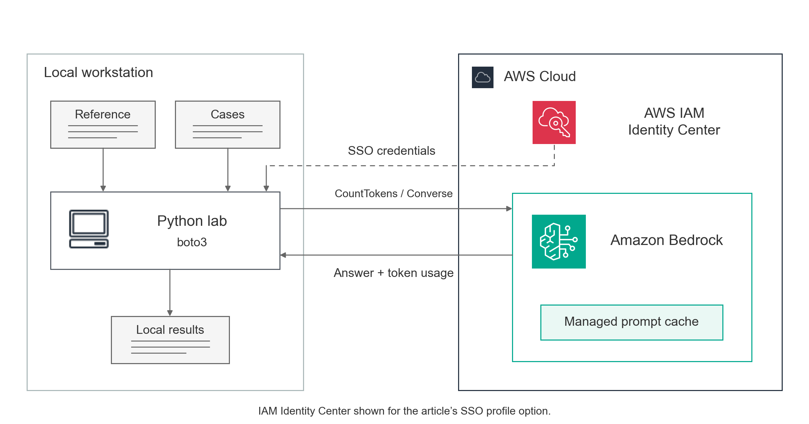
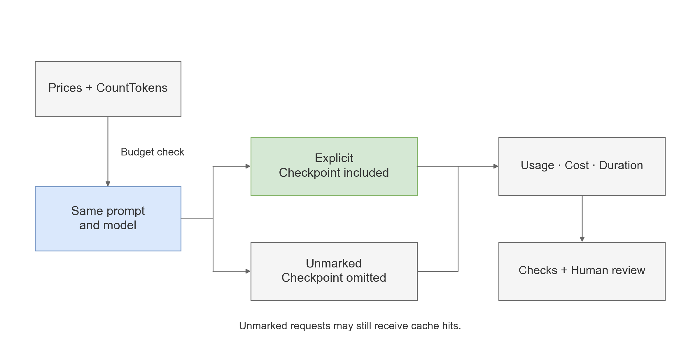

# Amazon Bedrock prompt caching lab

A small Python benchmark for measuring what prompt caching changes on Amazon Bedrock: token cost, request duration and answer quality, with the same prompts sent with and without an explicit cache checkpoint.

Built by [Mohammad AlYasfo](https://builder.aws.com/community/@mohammadyasfo), AWS Community Builder, for an article on reducing repeated prompt-input cost without removing context from the task.

## How it works



Everything runs on your workstation. The lab reads a shared operations reference and 50 synthetic payment-investigation cases. For each case it sends one Converse request to Claude Sonnet 4.6 through the `us.anthropic.claude-sonnet-4-6` inference profile from `us-east-1`. Two arms use byte-for-byte the same prompt: the explicit arm adds a cache checkpoint after the shared reference, the unmarked arm omits it.



Before any paid call the lab counts tokens with CountTokens, estimates the cost from a price file you verified, and refuses to start if the estimate exceeds the limit you pass. Each response returns token usage, and those counters are the only evidence of cache reuse. The lab writes JSON, CSV and text files to a local folder. It creates no AWS resources, makes no retries and no repair calls, and stops at the first failed request.

Three limits apply to every result. An unmarked request can still receive an implicit cache hit, so the comparison is unmarked versus explicit, not off versus on. The cost estimate is an application check, not a billing cap. The automated checks verify the decision, the number and the citations but do not read the explanation, so the lab also writes a short human review sheet.

## Run the lab

You need Python 3.11 or newer and Git. The live part also needs an AWS profile whose identity can call Claude Sonnet 4.6 in `us-east-1`: `bedrock:InvokeModel` on the inference profile and its destination foundation models, and `bedrock:CountTokens` on the foundation model. The commands below are for Windows PowerShell; on macOS or Linux use `.venv/bin/python`.

1. Clone and install.

```powershell
git clone https://github.com/Mohammad-Yasfo/bedrock-prompt-caching-lab.git
cd bedrock-prompt-caching-lab
python -m venv .venv
.\.venv\Scripts\python.exe -m pip install -r requirements.txt
```

2. Check everything offline. These commands make no AWS calls.

```powershell
.\.venv\Scripts\python.exe -m unittest discover -s tests
.\.venv\Scripts\python.exe -m lab.benchmark offline
```

3. Set the prices. Copy `example-prices.json` to `prices.local.json`, replace the four rates with the current ones from the [Bedrock pricing page](https://aws.amazon.com/bedrock/pricing/) for the US inference profile, set `verified` to `true` and `verified_on` to today's date as `YYYY-MM-DD`. The file is ignored by Git and rejected after seven days.

4. Run the five-case smoke experiment: 20 calls, two arms, two repeats, stopped before inference if the estimate exceeds one dollar.

```powershell
.\.venv\Scripts\python.exe -m lab.benchmark run --profile YOUR_AWS_PROFILE --experiment session-a --mode paired --limit 5 --repeats 2 --max-usd 1 --out results/session-a
```

5. Read the results. The report rebuilds the summary and the review sheet; the renderer writes a Markdown section with every counter, cost, duration and check, plus the saved answers for one case.

```powershell
.\.venv\Scripts\python.exe -m lab.benchmark report results/session-a
.\.venv\Scripts\python.exe tools/render_run.py results/session-a --case decline-01
```

For an expiry probe, use a new experiment label with `--mode explicit --limit 2 --repeats 1 --gap-seconds 310`. For a prefix-change probe, change `--revision` and choose a new output folder.

## Result files

| File | Contents |
|---|---|
| `metadata.json` | Model, Region, SDK version, prompt and dataset hashes, settings and prices |
| `requests.jsonl` | Per-request usage, observed cache state, cost, duration and checks |
| `summary.json` | Per-arm totals and interpretation limits |
| `review.csv` | Human review sheet linked to the saved answers |
| Numbered `.txt` files | The model answers, exactly as returned |
| `run-section.md` | Markdown rendered from the files above |

`cost_per_passing_case_usd` divides all known token cost by the number of answers that passed the automated checks. The priced uncached equivalent applies ordinary input prices to the same observed tokens; it is arithmetic, not a second run. Duration is the full synchronous request time, not time to first token.

## Repository files

- [lab/benchmark.py](lab/benchmark.py): offline example, bounded live runner and report.
- [lab/reference.txt](lab/reference.txt) and [lab/cases.json](lab/cases.json): the shared reference and the 50 cases.
- [tools/render_run.py](tools/render_run.py): renders a results section from a run folder.
- [tools/build_cases.py](tools/build_cases.py): regenerates the synthetic cases.
- [tests](tests): accounting, evaluator, request-shape, runner and renderer tests.
- [assets](assets): the two diagrams as PNG and SVG with their draw.io sources.
- [example-prices.json](example-prices.json): example rates, rejected by the live runner until replaced and verified.

The CI workflow runs the offline tests and the offline command only. It has no AWS credentials.

## License

Code and diagrams are under the [MIT license](LICENSE). The architecture diagram embeds official [AWS Architecture Icons](https://aws.amazon.com/architecture/icons/), which remain subject to AWS's terms. Product names belong to their owners.
